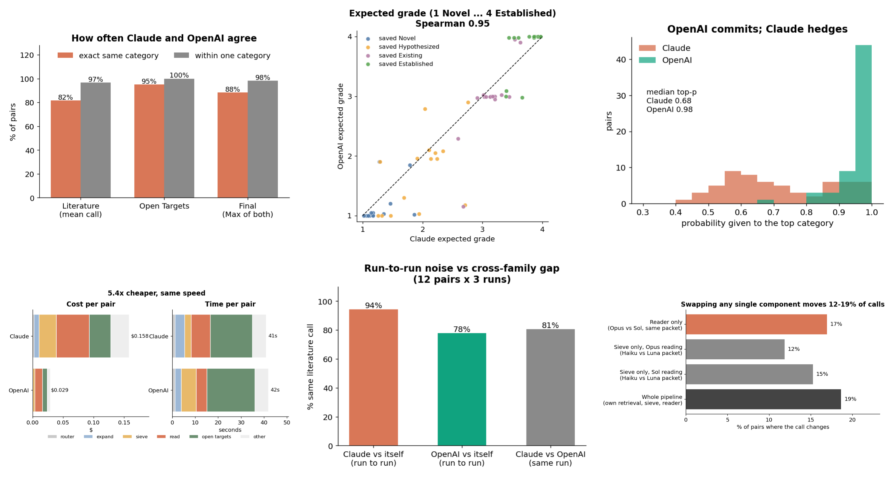
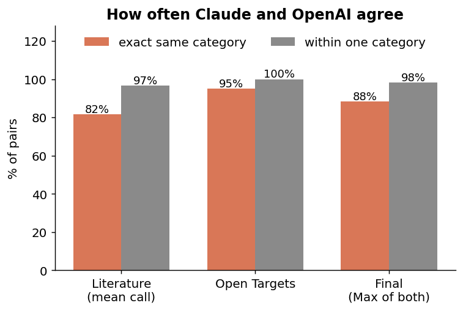
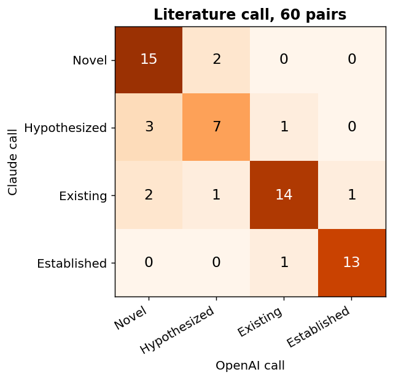
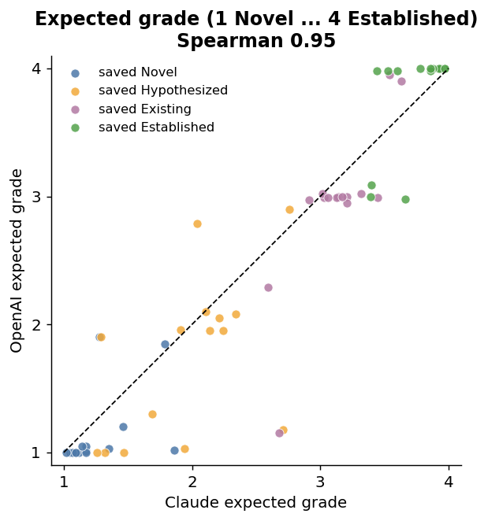
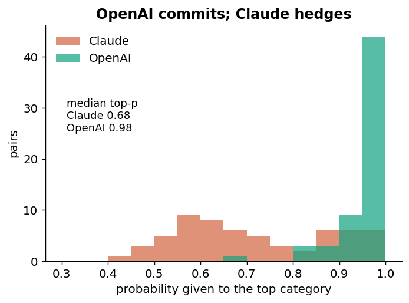
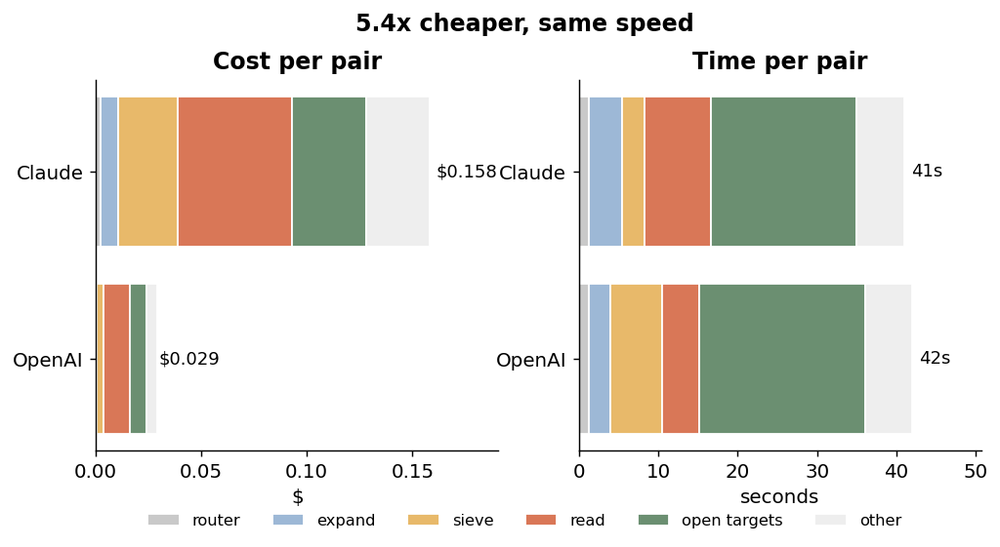
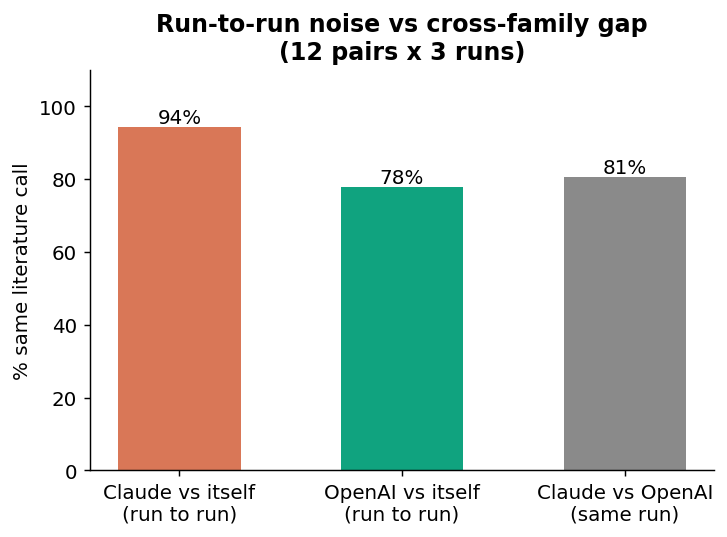
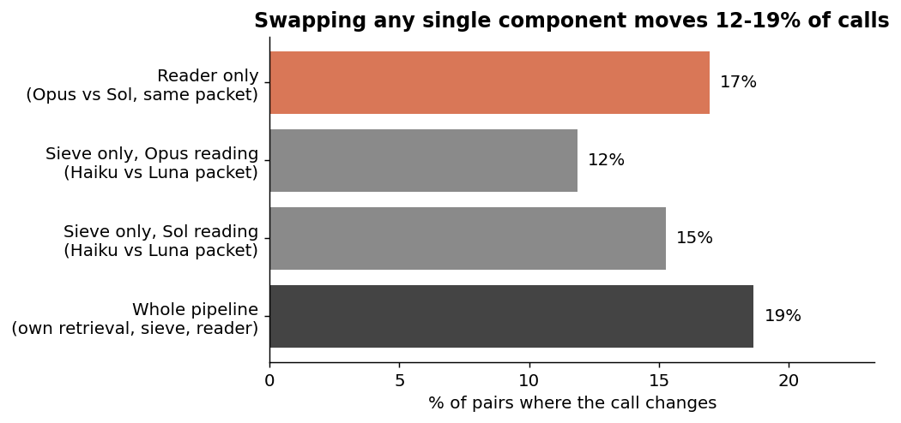
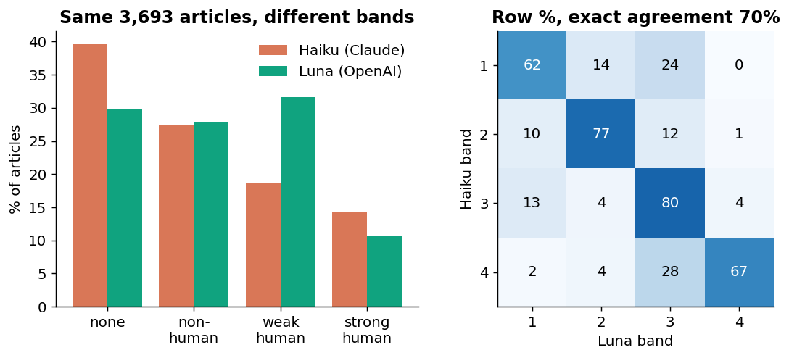

# Supplementary Material: PESTO development log

*Features and experiments, each on its own branch, with the results obtained*

**Repository.** [https://github.com/didiii-e/PESTO-release](https://github.com/didiii-e/PESTO-release) (fork of the PESTO release repository). **Compiled** 25 October 2026.

**Convention.** One branch is one feature or one experiment. Each entry below gives the branch, the commit it starts from,
its commits, what it does, how it was checked, the results, and what is not yet established. Nothing here has been
merged; every branch is pushed and waiting. Sections S1 to S3 are code features. Section S4 is an experiment (a
comparison of Claude and OpenAI models run through PESTO); its code, reports, tables and figures are on its branch.
The numbers in S4 are copied from the generated report files, not retyped.

**How to read the statuses.** *Pushed* means the branch is on the fork. *Validated* means the offline test suites listed
for it pass. A statement that a result is *not established* means it was not measured.

### Table S0. Branches

| ID | Kind | Branch | Starts from | Head | Status |
|---|---|---|---|---|---|
| S1 | Feature: runtime | [`efficiency/cost-and-runtime`](https://github.com/didiii-e/PESTO-release/tree/efficiency/cost-and-runtime) | `main` @ [`874eb71`](https://github.com/didiii-e/PESTO-release/commit/874eb71) | [`18fda64`](https://github.com/didiii-e/PESTO-release/commit/18fda64) | Pushed. Validated (replay 139/139, runtime checks 0 failures). Conflicts with S2 (see S5). |
| S2 | Feature: OpenAI and Anthropic providers | [`feature/llm-provider-support`](https://github.com/didiii-e/PESTO-release/tree/feature/llm-provider-support) | `main` @ [`874eb71`](https://github.com/didiii-e/PESTO-release/commit/874eb71) | [`95c6dde`](https://github.com/didiii-e/PESTO-release/commit/95c6dde) for the provider work; the branch head [`314e6d5`](https://github.com/didiii-e/PESTO-release/commit/314e6d5) also carries S3 | Pushed. Validated (see S2). |
| S3 | Feature: `--reasoning LEVEL` | [`feature/reasoning-level`](https://github.com/didiii-e/PESTO-release/tree/feature/reasoning-level) | S2 @ [`95c6dde`](https://github.com/didiii-e/PESTO-release/commit/95c6dde) | [`314e6d5`](https://github.com/didiii-e/PESTO-release/commit/314e6d5) | Pushed. Validated (23 new checks plus every earlier suite). Stacked on S2. |
| S4 | Experiment: Claude vs OpenAI through PESTO | [`experiment/claude-vs-openai-benchmark`](https://github.com/didiii-e/PESTO-release/tree/experiment/claude-vs-openai-benchmark) | S2 @ [`95c6dde`](https://github.com/didiii-e/PESTO-release/commit/95c6dde) (the exact commit benchmarked) | see branch | Pushed. Complete, $26.02 spent of a $40 cap. |

---

## S1. Runtime: about 2x faster per pair, same models, prompts, cost and answers

**Branch** [`efficiency/cost-and-runtime`](https://github.com/didiii-e/PESTO-release/tree/efficiency/cost-and-runtime). **Commits** [`d54910d`](https://github.com/didiii-e/PESTO-release/commit/d54910d) Runtime: about 2x faster per pair (24 Oct 2026),
[`18fda64`](https://github.com/didiii-e/PESTO-release/commit/18fda64) Reproducibility and robustness follow-ups (24 Oct 2026). **Starts from** `main` @ [`874eb71`](https://github.com/didiii-e/PESTO-release/commit/874eb71).

**Purpose.** Make one PESTO run cheaper and faster without changing what it answers (request from Jeremy). The default
pipeline is unchanged: the same searches, prompts and models, and the same arm fingerprint.

**What changed, by where the time went.**
- Open Targets runs alongside the literature branch instead of after it. This is the largest single saving.
- A disease-name embedding cache (one vector per name and encoder, per machine), saving 2 to 3 s per pair.
- Phenotype expansion starts without waiting for the local expanders.
- One PubMed `esummary` pass over the unique PMIDs, kept in a bounded LRU cache (10,000 records); pooled keep-alive connections.
- Banding calls to Haiku in parallel (16 workers instead of 6); the batches, prompts and model are the same.
- Opt-in only, not default: the `abstracts-fast` arms (title sieve, batches of twenty) and `--expansion-cache`
  (one expansion per phenotype). Both change the fingerprint or the answers' provenance, so neither is on by default.
- Per-stage timing in every run; default pair workers 20 to 10; encoder revisions pinned; a failed `esummary` is no longer cached as "no record".

**Results (live Anthropic, PubMed with an NCBI key, Open Targets).**

| measurement | original | optimized |
|---|---|---|
| One pair, nothing cached (12 runs per version; DDX41, BRCA1, MEF2C, SLTM, interleaved) | 46 s | 24 s (1.9x) |
| Group of 20 mixed pairs, 10 at a time | 117 s | 80 s (1.5x) |
| Cost of that 20-pair group | $3.10 | $3.09 |

Agreement on the same 20 mixed pairs: literature verdict identical for 18/20 and one level apart for 2/20 (none two or more apart);
Open Targets verdict identical for 18/20 and one level apart for 2/20; P(Established) r = 0.997, mean difference 1.9 points. For
scale, the optimized code run twice on 20 autism genes agrees with itself on 17/20 and with the published `pesto.tsv` rows on 16/20,
which is the size of normal Opus sampling variation.

**Table S1. Pair workers (20 mixed pairs, live APIs, NCBI key, no cache, two runs per setting in forward and reverse order).**

| workers | batch (s) | pairs/min | steady pairs/min | pair median (s) | pair p90 (s) |
|---|---|---|---|---|---|
| 2 | 254.8 | 4.7 | 5.1 | 22.4 | 28.8 |
| 4 | 130.8 | 9.2 | 10.2 | 23.0 | 28.2 |
| 6 | 97.2 | 12.4 | 14.4 | 24.2 | 32.6 |
| 8 | 78.5 | 15.4 | 17.7 | 27.1 | 33.0 |
| 10 | 72.4 | 16.7 | 21.7 | 27.8 | 34.2 |
| 20 | 60.0 | 20.0 | 25.0 | 49.0 | 54.8 |

Throughput keeps rising to 20 workers (about 15% over 10 in steady state), but pair latency doubles because the shared NCBI
rate gate queues calls (median wait 2.0 s per call at 20 workers against 0.22 s at 10). Ten workers keeps near-peak throughput
with latency at its floor; no SDK retries, timeouts or failed pairs occurred at any setting.

**Validation.** `tests/replay.py` 139/139 unchanged (this branch adds the two opt-in arms, hence 139 and not 137);
`tests/runtime_checks.py` (new, offline) 0 failures.

**Not established.** The 140-pair average-precision comparison was not run (about $21 for the optimized code alone), so n = 20
can rule out breakage but not a small accuracy shift. The expansion cache is untested at 100 to 200 genes. The 20-pair group
timings were read from run logs and not rerun for the figures.

---

## S2. Provider support: run PESTO on OpenAI models as well as Anthropic's

**Branch** [`feature/llm-provider-support`](https://github.com/didiii-e/PESTO-release/tree/feature/llm-provider-support). **Starts from** `main` @ [`874eb71`](https://github.com/didiii-e/PESTO-release/commit/874eb71).
**Commits** (24 to 25 Oct 2026):
[`275b902`](https://github.com/didiii-e/PESTO-release/commit/275b902) Tests: pin the Anthropic request behaviour of the LLM layer;
[`447e435`](https://github.com/didiii-e/PESTO-release/commit/447e435) Fix: retry without temperature when the API refuses it for a model;
[`2bf9b41`](https://github.com/didiii-e/PESTO-release/commit/2bf9b41) Provider support: run PESTO on OpenAI models as well as Anthropic's;
[`95c6dde`](https://github.com/didiii-e/PESTO-release/commit/95c6dde) Fix: --bench with an explicit --arm crashed every pair on `routed`.

**Purpose.** Let PESTO call OpenAI models without changing anything about how it calls Claude.

**What it does.**
- A model is named by a spec: a bare name is Anthropic, as it always was; `openai:NAME[@effort]` is OpenAI (Responses API,
  explicit reasoning effort; `gpt-6.1-sol` defaults to medium and `gpt-6-luna` to low).
- `--model` and `--model-fast` take either, and so do the new `--router-model`, `--ot-gate-model` and `--ot-reader-model`.
- A provider interface with two adapters. The Anthropic adapter is the call PESTO has always made, moved unchanged. The OpenAI
  adapter reports retries, refusals and truncation in PESTO's own words and counts reasoning tokens as output.
- A run asks for the key of each provider it will call and no other, before anything is fetched or paid for.
- Open Targets gate and reader models are configurable and are part of the cache key, so an answer is reused only by the models
  that gave it; the published pair leaves every existing key unchanged.
- OpenAI list prices were added; a model with no price is reported as unpriced and never charged at another model's rate.

**Two defects found and fixed on the way (separate commits).**
- Claude Haiku 4.5 now answers a request that carries a temperature with a 400 ("Extra inputs are not permitted"), as Opus 4 and
  later always did, so every Haiku call of a run failed. The model is now remembered and called without it, with a warning.
- Introduced and fixed within this branch: `--bench` with an explicit `--arm` raised `UnboundLocalError` on `routed` for every
  pair. Released code did not have it.

**Table S2. Validation (all offline: no network, no key).**

| suite | what it checks | result |
|---|---|---|
| `tests/anthropic_requests.py` | the exact Anthropic request, streaming, retries, errors and token counts, against a recording made before the refactor | 21/21 unchanged |
| `tests/anthropic_temperature.py` | the temperature fallback; fails without the fix | 3/3 |
| `tests/llm_providers.py` | specs, keys, OpenAI adapter against real SDK response objects, Open Targets keys and records, pricing, CLI, router | 59/59 |
| `tests/replay.py` | recorded blocks and fingerprints | 137/137 unchanged |

**Not established.** OpenAI models are candidates to be benchmarked, not validated replacements for Haiku and Opus. Section S4 is
that benchmark, and it measures agreement with Claude, not accuracy.

---

## S3. `--reasoning LEVEL`: one reasoning level for a run, passed to OpenAI or Claude

**Branch** [`feature/reasoning-level`](https://github.com/didiii-e/PESTO-release/tree/feature/reasoning-level). **Commit** [`314e6d5`](https://github.com/didiii-e/PESTO-release/commit/314e6d5) Add --reasoning LEVEL (25 Oct 2026).
**Stacked on S2**: it needs the provider layer, so merge S2 first. (The S2 branch head also contains this commit.)
**Origin.** Suggestion from Jeremy: add the reasoning level as a parameter of PESTO, passed down to OpenAI or Claude.

**Design decisions** (chosen by the project owner): one global flag; a level written in a model's own spec wins over it;
opt-in for Claude; a shared level vocabulary.

**What it does.**
- `--reasoning {none,low,medium,high,max}` sets the default level for every model the run calls: the literature steps, the
  `--arm auto` router and both Open Targets models. OpenAI receives it as `reasoning.effort`; Claude as `output_config.effort`
  (which Claude had no way to set before). `xhigh` exists for both and is spelled only in a spec (`MODEL@xhigh`).
- The level is part of the canonical model name, so it enters every fingerprint and cache key; a run is never reused at a different level.
- Claude gets extra output room per level (4k for `low` up to 64k for `max`), because thinking counts against the output cap.
- Claude has no off level, so `none` is refused for Claude (and for `gpt-6.1-sol`, whose lowest level is `low`).
  An unrunnable level stops the run before anything is fetched, naming the flag and the model.
- A refusal of the level by the API is raised, never retried without it, so a run cannot record a level it did not have.

**Finding from live calls: Claude Haiku 4.5 takes no reasoning level.** The API answers 400 "This model does not support the
effort parameter". PESTO's default arm uses Haiku for banding, broadening and the Open Targets gate, so a global flag would have
failed mid-run. The flag therefore leaves a model that has no level alone and says so on stderr; the fingerprint records that it
ran without one. Writing `claude-haiku-4-5@low` yourself is refused up front.

**Table S3. Live checks (one tiny prompt each: "Reply with the single word: ok").**

| spec | result | input / output tokens | list-price cost |
|---|---|---|---|
| `claude-haiku-4-5` | answered | 14 / 4 | $0.000034 |
| `claude-haiku-4-5@low` | refused: 400, effort not supported by the model | n/a | n/a |
| `claude-opus-5@low` | answered | 16 / 4 | $0.00018 |
| `claude-opus-5@max` | answered | 16 / 4 | $0.00018 |
| `openai:gpt-6-luna@max` | answered | 13 / 5 | $0.0000038 |

**Evidence that a run without the flag is unchanged.** Every arm's fingerprint and model list, the Open Targets defaults, the
router and the alias table are byte-identical to the previous commit (compared programmatically); the Anthropic request
recording (21/21) and the replay (137/137) are unchanged; no prompt or fixture changed.

**Validation.** `tests/reasoning_level.py` (new): 23 checks covering parsing and canonical form, the Claude request with and
without a level, both SDK shapes, the API-refusal backstop, the temperature retry, fingerprints, precedence, the router and Open
Targets, early refusals and key requirements. All earlier suites pass unchanged.

**Not established.** No full pair has been run with the flag, and no experiment on how reasoning level changes verdicts has been
run. Opus 5's API default is already `high`, so `--reasoning high` on Claude should behave like no flag but is cached separately.

---

## S4. Experiment: Claude and OpenAI models through PESTO

**Branch** [`experiment/claude-vs-openai-benchmark`](https://github.com/didiii-e/PESTO-release/tree/experiment/claude-vs-openai-benchmark). **Code under test** S2 @ [`95c6dde`](https://github.com/didiii-e/PESTO-release/commit/95c6dde), working tree clean at launch.
Date: 25 October 2026. The branch holds the instrumentation and analysis scripts, the pair tables, the three generated reports,
the figures and the run manifest.

**Question.** If PESTO is run end to end on OpenAI models instead of Claude, how often does the verdict change, and where does a
change come from (retrieval, the sieve that picks what the reader sees, the reader, or sampling)?

**Design.**
- 60 gene-phenotype pairs: 15 each of saved Established, Existing, Hypothesized and Novel; 22 borderline; 14 on the trait arm.
  The table's SHA-256 is `bb2643c71bee3ab0c5f62335f23fdb0c069e39f7da81e192d0b073027b670f98`.
- Two families, same table, same order, run concurrently through the real `pesto --bench` path, `--arm auto`, `--no-cache`, 3 workers.
- No date ceiling: `--max-date` skips Open Targets, which is one of the comparison axes. Both families therefore read the current
  PubMed at the same time of day, and retrieval overlap is reported.
- Stages: (1) end to end, 60 pairs by 2 families; (2) frozen-input: re-run one stage on the other family's recorded inputs so
  the stage is isolated; (3) stability: 12 pairs by 2 extra end-to-end runs per family.
- Nothing about prompts, models, reasoning settings or logic was changed during the benchmark. The instrumentation only wraps
  calls to record them.

**Table S4. Models and settings.**

| role | Claude family | OpenAI family |
|---|---|---|
| reader, synonyms, router, Open Targets reader | `claude-opus-5` | `openai:gpt-6.1-sol` (effort medium) |
| sieve, broaden, Open Targets gate | `claude-haiku-4-5` | `openai:gpt-6-luna` (effort low) |
| list price per million tokens in / out | Opus $5.00 / $25.00; Haiku $1.00 / $5.00 | Sol $2.00 / $10.00; Luna $0.10 / $0.50 |

Environment: Python 3.12.5 on macOS 15.1 (arm64); anthropic SDK 2.3.0; openai SDK 3.37.0; torch 2.4.0. Offline suites passed
before launch (21/21, 3/3, 59/59, 137/137). Total spend $26.02 against a $40 hard stop (about $11.2 end to end, $4.7 stability,
$10.1 frozen-input stages).

**Verification that the two families saw identical prompts.** The reader prompt was verified identical between families on
84/84 reader calls, and across all 8 prompt templates on 2,115 logged calls; the frozen-input stage asserts that the packet it
hands the reader matches the live read for 59/59 pairs and that the prompt is byte-identical for 59/59 pairs. The prompt text
therefore does not explain any difference below.

### S4.1 End to end, 60 pairs by 2 families

**Key results.** The headline literature call agrees exactly on 49/60 pairs (82%) and within one level on 58/60 (97%), quadratic kappa 0.89. Open Targets agrees on 56/59 (95%). The final verdict, Max(literature, Open Targets), agrees on 53/60 (88%) and within one level on 59/60. Continuous expected grade correlates at Spearman 0.948. The router chose the same arm on 60/60 pairs. Claude's probabilities are much less sharp (mean entropy 1.05 against 0.23 bits; 0/60 one-hot against 22/60). OpenAI cost 5.4 times less per pair at equal wall time.

#### S4.1.1 Category agreement

| measure | exact | within 1 | kappa | quad. kappa |
|---|---|---|---|---|
| literature, mean call (headline) | 49/60 (82%) | 58/60 (97%) | 0.75 | 0.89 |
| literature, argmax | 47/60 (78%) | 58/60 (97%) | 0.71 | 0.89 |
| Open Targets verdict | 56/59 (95%) | 59/59 (100%) | 0.93 | 0.98 |
| final Max(lit mean, OT) | 53/60 (88%) | 59/60 (98%) | 0.84 | 0.93 | 

##### Confusion, literature mean call (rows Claude, cols OpenAI)

| Claude \ OpenAI | Novel | Hypothesized | Existing | Established | n |
|---|---|---|---|---|---|
| Novel | 15 | 2 | 0 | 0 | 17 |
| Hypothesized | 3 | 7 | 1 | 0 | 11 |
| Existing | 2 | 1 | 14 | 1 | 18 |
| Established | 0 | 0 | 1 | 13 | 14 | 

##### Confusion, final Max (rows Claude, cols OpenAI)

| Claude \ OpenAI | Novel | Hypothesized | Existing | Established | n |
|---|---|---|---|---|---|
| Novel | 10 | 1 | 0 | 0 | 11 |
| Hypothesized | 1 | 11 | 1 | 0 | 13 |
| Existing | 1 | 2 | 12 | 0 | 15 |
| Established | 0 | 0 | 1 | 20 | 21 | 

##### Confusion, Open Targets verdict (rows Claude, cols OpenAI)

| Claude \ OpenAI | Novel | Hypothesized | Existing | Established | n |
|---|---|---|---|---|---|
| Novel | 14 | 0 | 0 | 0 | 14 |
| Hypothesized | 3 | 19 | 0 | 0 | 22 |
| Existing | 0 | 0 | 8 | 0 | 8 |
| Established | 0 | 0 | 0 | 15 | 15 | 

Direction of the literature mean-call disagreements: OpenAI higher on 4 pairs, OpenAI lower on 7 

##### Agreement by stratum (literature mean call)

| stratum | n | exact | within 1 | mean E[grade] OpenAI-Claude |
|---|---|---|---|---|
| borderline | 22 | 17/22 (77%) | 20/22 (91%) | -0.19 |
| disease pair | 46 | 39/46 (85%) | 45/46 (98%) | -0.08 |
| non-borderline | 38 | 32/38 (84%) | 38/38 (100%) | -0.08 |
| saved Established | 15 | 13/15 (87%) | 15/15 (100%) | +0.06 |
| saved Existing | 15 | 13/15 (87%) | 14/15 (93%) | -0.19 |
| saved Hypothesized | 15 | 10/15 (67%) | 14/15 (93%) | -0.22 |
| saved Novel | 15 | 13/15 (87%) | 15/15 (100%) | -0.11 |
| trait pair | 14 | 10/14 (71%) | 13/14 (93%) | -0.24 | 

#### S4.1.2 Continuous expected grade

Spearman 0.948 (p=1.9e-30), Pearson 0.935; mean diff OpenAI-Claude -0.116, mean |diff| 0.290, within 0.5 of each other 51/60, >1.0 apart 2

#### S4.1.3 Probability sharpness

| family | mean entropy (bits) | median | mean top-p | median | exactly one-hot | top-p >= 0.9 |
|---|---|---|---|---|---|---|
| claude | 1.05 | 1.19 | 0.71 | 0.68 | 0/60 (0%) | 12/60 (20%) |
| openai | 0.23 | 0.14 | 0.95 | 0.98 | 22/60 (37%) | 53/60 (88%) | 

#### S4.1.4 Router

arm agreement 60/60 (100%)
- claude router vs the pair-table trait flag: 60/60 (100%)
- openai router vs the pair-table trait flag: 60/60 (100%)

#### S4.1.5 Retrieval: model or retrieval?

candidate-pool Jaccard (PMIDs): mean 0.86, median 0.93; read-set Jaccard: mean 0.46, median 0.48; synonym-list Jaccard: mean 0.28
pool size Claude/OpenAI mean 62/59; synonyms per pair 9.1/4.7 (note: Claude expands with Opus, OpenAI with Luna, because --model-fast covers that step)

##### Does the call depend on how much the read sets overlap? (literature mean call)

| stratum | n | exact | within 1 | mean |dE[grade]| |
|---|---|---|---|---|
| read-set Jaccard < 0.34 | 24 | 18/24 (75%) | 23/24 (96%) | 0.35 |
| 0.34 - 0.67 | 22 | 20/22 (91%) | 22/22 (100%) | 0.22 |
| >= 0.67 | 13 | 10/13 (77%) | 12/13 (92%) | 0.31 | 

Spearman(read-set Jaccard, |dE[grade]|) = -0.12 (p=0.36)

#### S4.1.6 Sieve inside the live runs

| sieve | articles | pass (>=2) | human (>=3) | strong (4) | mean read per pair |
|---|---|---|---|---|---|
| claude (Haiku) | 3693 | 2230/3693 (60%) | 1217/3693 (33%) | 531/3693 (14%) | 15.7 |
| openai (Luna) | 3554 | 2515/3554 (71%) | 1550/3554 (44%) | 366/3554 (10%) | 16.3 | 

on PMIDs that both retrieved (3248 article-pairs): pass/reject agreement 79.8%, kappa 0.56

#### S4.1.7 Cost, latency and reliability

| family | total | mean/pair | median | mean wall | median wall | p90 wall | calls | API attempts | retries | refusals | non-end_turn / errored calls | reasoning/output tokens |
|---|---|---|---|---|---|---|---|---|---|---|---|---|
| claude | $9.48 | $0.158 | $0.166 | 41s | 40s | 55s | 753 | 753 | 0 | 0 | 0 | 0/217802 |
| openai | $1.75 | $0.029 | $0.030 | 42s | 40s | 58s | 739 | 739 | 0 | 0 | 0 | 173177/281980 | 

cost ratio Claude/OpenAI (all recorded pairs) = 5.4x; mean wall ratio Claude/OpenAI = 0.98

##### Where the cost and the time go (mean per pair)

| step | claude $ / s | openai $ / s |
|---|---|---|
| router | $0.0024 / 1.3s | $0.0004 / 1.2s |
| expand | $0.0081 / 4.1s | $0.0001 / 2.7s |
| sieve | $0.0282 / 2.9s | $0.0031 / 6.6s |
| read | $0.0543 / 8.3s | $0.0124 / 4.6s |
| open targets | $0.0351 / 18.4s | $0.0078 / 21.0s | 

#### S4.1.8 Disagreement list

| pair | saved | Claude lit (E/Ex/H/N) | OpenAI lit | dE | pool J | read J | OT C/O | Max C/O |
|---|---|---|---|---|---|---|---|---|
| DDX41 / red | Exist* | Existing (12/55/22/11) | Novel (0/5/5/90) | -1.53 | 0.85 | 0.82 | Novel/Novel | Exist/Novel |
| TRAF7 / Autism Spectrum Disorder | Hypot* | Existing (8/62/23/7) | Novel (0/8/2/90) | -1.53 | 0.99 | 0.03 | Hypot/Hypot | Exist/Hypot |
| APOB / Hemoglobin [Mass/volume] in Blood | Hypot | Hypothesized (3/18/49/30) | Novel (0/0/3/97) | -0.91 | 0.54 | 0.00 | Estab/Estab | Estab/Estab |
| PKD1 / Total cholesterol | Novel | Hypothesized (2/10/60/28) | Novel (0/0/2/98) | -0.84 | 0.91 | 0.29 | Hypot/Hypot | Hypot/Hypot |
| CSNK1E / Autism Spectrum Disorder | Hypot* | Hypothesized (2/23/52/23) | Existing (0/80/19/1) | +0.75 | 1.00 | 0.48 | Hypot/Hypot | Hypot/Exist |
| GRIA2 / Autism Spectrum Disorder | Estab | Established (70/26/4/0) | Existing (0/98/2/0) | -0.68 | 0.64 | 0.33 | Hypot/Hypot | Estab/Exist |
| SLTM / Autism Spectrum Disorder | Novel | Novel (0/3/22/75) | Hypothesized (0/0/90/10) | +0.62 | 0.78 | 0.11 | Hypot/Novel | Hypot/Hypot |
| ERP44 / schizophrenia | Hypot* | Novel (0/2/25/73) | Hypothesized (0/0/90/10) | +0.61 | 1.00 | 0.90 | Novel/Novel | Novel/Hypot |
| CETP / low density lipoprotein | Estab | Existing (55/36/7/2) | Established (98/2/0/0) | +0.54 | 0.60 | 0.18 | Estab/Estab | Estab/Estab |
| RANBP2 / Autism Spectrum Disorder | Hypot* | Hypothesized (1/17/32/50) | Novel (0/10/10/80) | -0.39 | 0.95 | 0.54 | Hypot/Hypot | Hypot/Hypot |
| BCR / Autism Spectrum Disorder | Hypot | Novel (1/5/19/75) | Novel (0/0/0/100) | -0.32 | 0.76 | 0.04 | Hypot/Novel | Hypot/Novel |
| TMEM135 / neurodevelopmental disorder | Exist | Existing (3/58/34/5) | Hypothesized (0/30/69/1) | -0.30 | 1.00 | 1.00 | Hypot/Hypot | Exist/Hypot | 

(* = borderline pair)

#### S4.1.9 Stability

| family | same call in all 3 runs | pairwise run-to-run agreement | mean sd of E[grade] | pool J run-to-run | read-set J run-to-run | router stable | OT verdict stable |
|---|---|---|---|---|---|---|---|
| claude | 11/12 (92%) | 34/36 (94%) | 0.05 | 0.87 | 0.55 | 12/12 (100%) | 12/12 (100%) |
| openai | 8/12 (67%) | 28/36 (78%) | 0.12 | 0.83 | 0.54 | 12/12 (100%) | 12/12 (100%) | 

cross-family agreement in the same run index: 29/36 (81%) (compare with each family's run-to-run agreement above)

| pair | saved | Claude r1 r2 r3 (E[grade]) | OpenAI r1 r2 r3 (E[grade]) |
|---|---|---|---|
| ABCE1 / mean corpuscular hemoglobin co | Novel* | Nov(1.4) Nov(1.5) Nov(1.4) | Nov(1.0) Nov(1.1) Hyp(1.7) |
| CCT7 / complex neurodevelopmental dis | Novel* | Nov(1.5) Nov(1.4) Nov(1.5) | Nov(1.2) Hyp(1.7) Hyp(1.8) |
| DGKE / Autism Spectrum Disorder | Novel | Nov(1.2) Nov(1.3) Nov(1.2) | Nov(1.0) Nov(1.0) Nov(1.0) |
| SMAD6 / Triglycerides | Hypot* | Nov(1.3) Nov(1.2) Nov(1.1) | Nov(1.0) Hyp(1.8) Nov(1.0) |
| ASCL1 / neurodevelopmental disorder | Hypot* | Exi(2.8) Exi(2.8) Exi(2.7) | Exi(2.9) Exi(2.9) Exi(2.9) |
| BRD4 / Autism Spectrum Disorder | Hypot | Hyp(2.3) Hyp(2.2) Hyp(2.3) | Hyp(2.1) Exi(2.8) Exi(2.8) |
| ZNF638 / Height | Exist* | Est(3.6) Exi(3.5) Est(3.6) | Est(3.9) Est(3.8) Est(3.8) |
| LRRC4 / Autism Spectrum Disorder | Exist* | Exi(2.9) Exi(2.9) Exi(2.8) | Exi(3.0) Exi(3.0) Exi(3.0) |
| SS18L1 / amyotrophic lateral sclerosis | Exist | Exi(3.0) Exi(3.1) Exi(3.2) | Exi(3.0) Exi(3.0) Exi(3.0) |
| DDX41 / myelodysplastic syndrome | Estab | Est(3.9) Est(3.9) Est(3.9) | Est(4.0) Est(4.0) Est(4.0) |
| TRIO / Autism Spectrum Disorder | Estab | Exi(3.4) Exi(3.4) Exi(3.2) | Exi(3.0) Exi(3.0) Exi(3.0) |
| NRXN1 / Autism Spectrum Disorder | Estab | Est(3.6) Est(3.7) Est(3.6) | Est(4.0) Est(4.0) Est(4.0) | 

stability spend (r2+r3): Claude $4.00, OpenAI $0.74

### S4.2 Frozen-input comparisons: isolating one stage
Everything below goes through production code (`harness.band`, `harness.select_bands`, `arm.read.run`, `arm.judge.run`) on the
inputs the Claude run recorded, so only the named stage differs. 59 of the 60 pairs have a candidate pool.

#### A. Sieve on the identical pool (same articles, synonyms, batches, prompt)

3693 articles; articles left unbanded by Haiku/Luna (defaulted to 2, as production does): none (all 3693 were banded)

| Haiku \ Luna (band) | 1 none | 2 nonhuman | 3 weak | 4 strong | n |
|---|---|---|---|---|---|
| 1 none | 910 | 201 | 352 | 0 | 1463 |
| 2 nonhuman | 100 | 784 | 118 | 11 | 1013 |
| 3 weak | 86 | 27 | 547 | 26 | 686 |
| 4 strong | 8 | 19 | 149 | 355 | 531 | 

| criterion | Haiku rate | Luna rate | agreement | kappa | Haiku-only | Luna-only |
|---|---|---|---|---|---|---|
| pass (band >= 2) | 60.4% | 70.1% | 79.8% | 0.56 | 194 | 553 |
| human (band >= 3) | 33.0% | 42.2% | 83.2% | 0.64 | 140 | 481 |
| strong (band 4) | 14.4% | 10.6% | 94.2% | 0.74 | 176 | 37 | 

exact band agreement 70.3%; within one band 87.1%; weighted kappa 0.68

packet handed to the reader: Jaccard Haiku-vs-Luna selection mean 0.51, median 0.48; identical in 3/59; mean size 15.9 vs 16.9

##### Sieve draw-to-draw stability (same pool; 12 stability pairs; Haiku draw 1 = the live run)

| sieve | draw pairs | exact band agreement | pass/reject agreement | mean kappa(pass) |
|---|---|---|---|---|
| Haiku | 36 | 90.5% | 92.3% | 0.74 |
| Luna | 36 | 86.1% | 91.3% | 0.69 | 

#### B. Readers on identical packets

| comparison (A vs B) | n | exact (mean call) | within 1 | quad. kappa | Spearman E | Pearson E | mean E B-A |
|---|---|---|---|---|---|---|---|
| READER only: Opus vs Sol on the Haiku packet | 59 | 49/59 (83%) | 58/59 (98%) | 0.92 | 0.973 | 0.957 | +0.02 |
| READER only: Opus vs Sol on the Luna packet | 59 | 51/59 (86%) | 59/59 (100%) | 0.95 | 0.973 | 0.974 | -0.06 |
| SIEVE only (Opus reading): Haiku packet vs Luna packet | 59 | 52/59 (88%) | 59/59 (100%) | 0.96 | 0.987 | 0.990 | -0.03 |
| SIEVE only (Sol reading): Haiku packet vs Luna packet | 59 | 50/59 (85%) | 56/59 (95%) | 0.89 | 0.957 | 0.927 | -0.11 |
| READER+SIEVE: Opus on Haiku packet vs Sol on Luna packet (same pool) | 59 | 51/59 (86%) | 58/59 (98%) | 0.93 | 0.956 | 0.956 | -0.09 |
| FULL PIPELINE: Claude e2e vs OpenAI e2e (own retrieval) | 59 | 48/59 (81%) | 57/59 (97%) | 0.89 | 0.946 | 0.933 | -0.12 | 

(For the 3 pairs where both sieves choose the same packet the Luna-packet answer is the Haiku-packet answer.)

##### Frozen readers' sharpness (same packets)

| reader / packet | n | mean entropy | mean top-p | exactly one-hot |
|---|---|---|---|---|
| Opus, Haiku packet (live Claude read) | 59 | 1.07 | 0.70 | 0/59 (0%) |
| Sol, Haiku packet | 59 | 0.26 | 0.94 | 17/59 (29%) |
| Sol, Luna packet | 59 | 0.25 | 0.95 | 19/59 (32%) |
| Opus, Luna packet | 59 | 1.03 | 0.71 | 0/59 (0%) | 

##### Confusion on the Haiku packet (rows Opus, cols Sol)

| Opus \ Sol | Novel | Hypothesized | Existing | Established | n |
|---|---|---|---|---|---|
| Novel | 13 | 3 | 0 | 0 | 16 |
| Hypothesized | 1 | 8 | 2 | 0 | 11 |
| Existing | 1 | 0 | 14 | 3 | 18 |
| Established | 0 | 0 | 0 | 14 | 14 | 

##### Frozen reader disagreements on the Haiku packet (mean call differs)

| pair | saved | Opus (E) | Sol (E) | packet n |
|---|---|---|---|---|
| DDX41 / red | Exist* | Existing (2.68) | Novel (1.20) | 20 |
| CSNK1E / Autism Spectrum Disorder | Hypot* | Hypothesized (2.04) | Existing (2.84) | 20 |
| SLTM / Autism Spectrum Disorder | Novel | Novel (1.28) | Hypothesized (1.90) | 15 |
| ERP44 / schizophrenia | Hypot* | Novel (1.29) | Hypothesized (1.85) | 20 |
| CETP / low density lipoprotein | Estab | Existing (3.44) | Established (3.90) | 20 |
| MEF2C / Autism Spectrum Disorder | Exist* | Existing (3.45) | Established (3.90) | 20 |
| LTBP1 / Height | Estab | Existing (3.40) | Established (3.85) | 20 |
| RANBP2 / Autism Spectrum Disorder | Hypot* | Hypothesized (1.69) | Novel (1.27) | 20 |
| BRD4 / Autism Spectrum Disorder | Hypot | Hypothesized (2.34) | Existing (2.65) | 20 |
| CCT7 / complex neurodevelopmental dis | Novel* | Novel (1.46) | Hypothesized (1.75) | 13 | 

##### Reader draw-to-draw stability (same packet; 12 stability pairs)

| reader | draw pairs | same mean call | mean sd of E[grade] |
|---|---|---|---|
| Opus | 36 | 36/36 (100%) | 0.04 |
| Sol | 36 | 36/36 (100%) | 0.01 | 

frozen-stage spend: $10.06 (sieve $1.29, readers $8.77)

### S4.3 Effect of the sieve on the verdict
The same frozen pools, with the reader held fixed, comparing what the Haiku sieve and the Luna sieve hand to the reader.

packets identical for 3 pairs (verdict cannot change there); different for 56

#### Reader = Opus

| verdict level | changed (all pairs) | size of change | if packets differ |
|---|---|---|---|
| literature mean call | 7/59 = 11.9% (95% CI 6-23%) | 7 one step, 0 two+ steps | 12.5% of the 56 pairs with different packets |
| literature argmax | 4/59 = 6.8% (95% CI 3-16%) | 4 one step, 0 two+ steps | 7.1% of the 56 pairs with different packets |
| final verdict Max(lit, Open Targets) | 1/59 = 1.7% (95% CI 0-9%) | 1 one step, 0 two+ steps | 1.8% of the 56 pairs with different packets | 

direction with Luna's sieve: 3 pairs go UP, 4 go DOWN (mean call)

expected grade shift (Luna - Haiku packet): mean -0.032, median |shift| 0.04, 90th pct |shift| 0.16, |shift| > 0.5 in 2 pairs

| pair | saved | Haiku packet (E) | Luna packet (E) | packet Jaccard | final Max |
|---|---|---|---|---|---|
| PKD1 / Total cholesterol | Novel | Hypothesized (1.86) | Novel (1.26) | 0.29 | Hypothesized -> Hypothesized |
| CSNK1E / Autism Spectrum Disorder | Hypothesized* | Hypothesized (2.04) | Novel (1.45) | 0.38 | Hypothesized -> Hypothesized |
| TRAF7 / Autism Spectrum Disorder | Hypothesized* | Existing (2.71) | Hypothesized (2.23) | 0.03 | Existing -> Hypothesized |
| CETP / low density lipoprotein | Established | Existing (3.44) | Established (3.84) | 0.33 | Established -> Established |
| LTBP1 / Height | Established | Existing (3.40) | Established (3.50) | 0.25 | Established -> Established |
| MEF2C / Autism Spectrum Disorder | Existing* | Existing (3.45) | Established (3.55) | 0.38 | Established -> Established |
| EYA4 / dilated cardiomyopathy 1J | Existing* | Established (3.54) | Existing (3.49) | 0.74 | Established -> Established | 

by saved category / stratum (literature mean call changed):

| stratum | n | changed |
|---|---|---|
| Novel | 14 | 1 |
| Hypothesized | 15 | 2 |
| Existing | 15 | 2 |
| Established | 15 | 2 |
| borderline | 22 | 4 |
| non-borderline | 37 | 3 | 

#### Reader = Sol

| verdict level | changed (all pairs) | size of change | if packets differ |
|---|---|---|---|
| literature mean call | 9/59 = 15.3% (95% CI 8-27%) | 6 one step, 3 two+ steps | 16.1% of the 56 pairs with different packets |
| literature argmax | 9/59 = 15.3% (95% CI 8-27%) | 6 one step, 3 two+ steps | 16.1% of the 56 pairs with different packets |
| final verdict Max(lit, Open Targets) | 4/59 = 6.8% (95% CI 3-16%) | 3 one step, 1 two+ steps | 7.1% of the 56 pairs with different packets | 

direction with Luna's sieve: 1 pairs go UP, 8 go DOWN (mean call)

expected grade shift (Luna - Haiku packet): mean -0.109, median |shift| 0.01, 90th pct |shift| 0.74, |shift| > 0.5 in 9 pairs

| pair | saved | Haiku packet (E) | Luna packet (E) | packet Jaccard | final Max |
|---|---|---|---|---|---|
| CSNK1E / Autism Spectrum Disorder | Hypothesized* | Existing (2.84) | Novel (1.05) | 0.38 | Existing -> Hypothesized |
| TRAF7 / Autism Spectrum Disorder | Hypothesized* | Existing (2.95) | Novel (1.25) | 0.03 | Existing -> Hypothesized |
| DDX41 / red | Existing* | Novel (1.20) | Existing (2.65) | 0.48 | Novel -> Existing |
| MEF2C / Autism Spectrum Disorder | Existing* | Established (3.90) | Existing (2.98) | 0.38 | Established -> Established |
| PKD1 / Total cholesterol | Novel | Hypothesized (1.92) | Novel (1.00) | 0.29 | Hypothesized -> Hypothesized |
| APOB / Hemoglobin [Mass/volume] in  | Hypothesized | Hypothesized (2.00) | Novel (1.12) | 0.29 | Established -> Established |
| ERP44 / schizophrenia | Hypothesized* | Hypothesized (1.85) | Novel (1.15) | 0.90 | Hypothesized -> Novel |
| LTBP1 / Height | Established | Established (3.85) | Existing (3.15) | 0.25 | Established -> Established |
| CCT7 / complex neurodevelopmental d | Novel* | Hypothesized (1.75) | Novel (1.15) | 0.72 | Hypothesized -> Hypothesized | 

by saved category / stratum (literature mean call changed):

| stratum | n | changed |
|---|---|---|
| Novel | 14 | 2 |
| Hypothesized | 15 | 4 |
| Existing | 15 | 2 |
| Established | 15 | 1 |
| borderline | 22 | 6 |
| non-borderline | 37 | 3 | 

#### Does the size of the packet change predict a verdict change? (Opus reading)

| packet Jaccard | n | Opus changed | Sol changed |
|---|---|---|---|
| 0.00-0.34 | 17 | 4 | 4 |
| 0.34-0.67 | 27 | 2 | 3 |
| 0.67-1.00 | 15 | 1 | 2 | 

#### Baselines (how much does the verdict move with no change of model at all?)

- Same packet, same reader, fresh draw (12 stability pairs): Opus 0/36 draw-pairs change, Sol 0/36 -> reader sampling noise is ~0, so a change after a sieve swap is caused by the packet, not by luck.
- Whole-pipeline rerun, Haiku sieve + Opus reader (fresh retrieval + fresh sieve draw): verdict changes in 2/36 run pairs (6%)
- Whole-pipeline rerun, Luna sieve + Sol reader (fresh retrieval + fresh sieve draw): verdict changes in 8/36 run pairs (22%)

### S4.4 Limitations of this experiment
- **Agreement, not accuracy.** The experiment measures how often OpenAI models agree with Claude through PESTO. It does not
  measure which family is closer to the truth, and a lower agreement does not mean OpenAI is worse.
- **Sampling is not controlled.** Opus and Haiku run at the API default temperature (the API refuses a fixed one), and OpenAI
  reasoning models take no sampling parameters. The stability stage (S4.1.9) measures the resulting run-to-run variation.
- **Reasoning settings were the defaults** (`gpt-6.1-sol` medium, `gpt-6-luna` low) and were not varied. The `--reasoning` flag
  (S3) exists so that they can be.
- **Different synonym models.** `--model-fast` also covers the synonym step, so Claude expands with Opus and OpenAI with Luna
  (9.1 against 4.7 synonyms per pair). That is a stage difference between the families, reported in S4.1.5.
- **Claude reasoning tokens are not reported by the API**, so the 0 in the reliability table is "not reported", not "none used".
- **Live literature.** Both families read the current PubMed, so results move over time; the two families ran at the same time of day.
- **n = 60**, 15 per saved category; confidence intervals are in S4.3 where they were computed.

### S4.5 Reproduction
Run from the repository root at the commit above, with keys for both providers (see the README):
`run_e2e.py --rep r1 --pairs pairs.tsv --out runs/r1`; `frozen.py` for the frozen-input stages; then `an_e2e.py`, `an_frozen.py`
and `an_sieve_effect.py` for the three reports and `figs.py` for the figures. The scripts use `instr.py`, which only records calls.
The scripts refer to their working directory as `/Users/dinan_elsyad/pesto_cmp`; change `ROOT` in `an_common.py` and `instr.py` to
reproduce elsewhere. The raw call logs (`ledger.jsonl`, `frozen_*.jsonl`, `runs/`) contain article text and are not in the branch.

---

## S5. How the branches relate, and what merging them involves

- **S3 depends on S2.** S3 is the single commit [`314e6d5`](https://github.com/didiii-e/PESTO-release/commit/314e6d5) on top of S2's [`95c6dde`](https://github.com/didiii-e/PESTO-release/commit/95c6dde). Merge S2, then S3. The S2
  branch already contains S3, so merging [`feature/llm-provider-support`](https://github.com/didiii-e/PESTO-release/tree/feature/llm-provider-support) alone brings both; [`feature/reasoning-level`](https://github.com/didiii-e/PESTO-release/tree/feature/reasoning-level) exists so
  that S3 can be reviewed and merged on its own.
- **S4 depends on S2** for the code it ran, and adds only files under `experiments/`; it changes no source.
- **S1 and S2 conflict.** They were built independently from the same `main` commit and both touch the LLM layer and the
  Open Targets code. A trial merge (`git merge-tree`, 25 Oct 2026) reports content conflicts in `src/pesto/cli.py`,
  `src/pesto/ot_matcher.py` and `src/pesto/services/llm_service.py`. Both implement the same Haiku temperature fallback
  (S1 in `llm_service.py`, S2 in the Anthropic adapter); the S2 version is the one that survives the move to adapters. The
  `ot_matcher.py` conflict is substantive: S1 asks the Open Targets gate and reader together, and S2 makes those two models configurable.
  This needs a deliberate resolution, not a mechanical one, and whichever branch merges second should be rebased on the first.
- **Test counts differ between branches by design.** S1 reports replay 139/139 (it adds two arms); S2 and S3 report 137/137.

